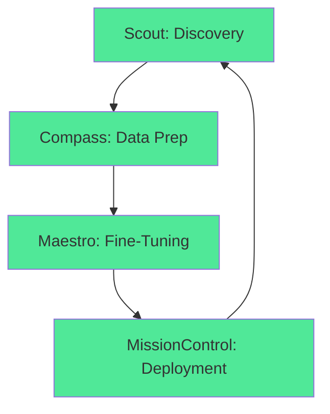

## Overview

Percepteye AI powers autonomous, self-improving AI agents through a continuous learning architecture. You build production-ready agents that simulate, fine-tune, and deploy without constant manual intervention. The system revolves around the **Agent Flywheel Effect**, where components like Scout, Compass, Maestro, and MissionControl work together to create a closed-loop learning process.

<Callout kind="info">
  Start with Scout to map your systems, then progress through the flywheel for full autonomy.
</Callout>

## Agent Flywheel Effect

The flywheel accelerates agent improvement over time. Agents observe environments, learn from simulations, fine-tune models, and deploy updates seamlessly.



This loop ensures your agents adapt continuously, reducing inference costs while maintaining performance.

## Core Components

Discover the key agents that drive the flywheel.

<Columns cols={2}>
  <Card title="Scout" icon="search" href="/concepts/scout">
    Maps your systems and generates observable workflows. Use it as your entry point to make existing agents smarter without training.
  </Card>
  <Card title="Compass" icon="compass" href="/concepts/compass">
    Prepares clean data and defines learning signals from Scout's workflows. Ideal for data teams building reproducible training systems.
  </Card>
  <Card title="Maestro" icon="music" href="/concepts/maestro">
    Handles fine-tuning experiments, model selection, and evaluation. Delivers deploy-ready models for any serving stack.
  </Card>
  <Card title="MissionControl" icon="settings" href="/concepts/missioncontrol">
    The shared engine orchestrating deployment, monitoring, and resilience across all agents.
  </Card>
</Columns>

## Continuous Learning Workflow

Follow these steps to implement the flywheel in your project.

<Steps>
  <Step title="Map Systems" icon="map">
    Deploy Scout to discover workflows.
    
    ```bash
    npm install @percepteye/sdk
    npx percepteye scout init
    ```
  </Step>
  <Step title="Prepare Data" icon="database">
    Use Compass to refine datasets.
    
    ```bash
    npx percepteye compass prepare --workflow scout-output
    ```
  </Step>
  <Step title="Fine-Tune" icon="zap">
    Run Maestro for model optimization.
    
    ```bash
    npx percepteye maestro train --data compass-data --base gpt-4o-mini
    ```
  </Step>
  <Step title="Deploy" icon="rocket">
    MissionControl handles rollout and monitoring.
    
    ```bash
    npx percepteye missioncontrol deploy --model maestro-output
    ```
  </Step>
</Steps>

## SDK Integration Examples

Integrate the Agent Flywheel SDK across languages for observability and upgrades.

<CodeGroup tabs="JavaScript,Python">
  ```javascript
  import { AgentFlywheel } from '@percepteye/sdk';

  const flywheel = new AgentFlywheel({
    apiKey: 'YOUR_API_KEY',
    endpoint: 'https://api.example.com/v1'
  });

  await flywheel.scout.mapSystems({ systems: ['crm', 'erp'] });
  ```
  ```python
  from percepteye import AgentFlywheel

  flywheel = AgentFlywheel(
      api_key="YOUR_API_KEY",
      endpoint="https://api.example.com/v1"
  )

  await flywheel.scout.map_systems(systems=["crm", "erp"])
  ```
</CodeGroup>

## Platform-Specific Setup

Customize setup based on your environment.

<Tabs>
  <Tab title="Node.js" icon="nodejs">
    Install and initialize.
    
    ```bash
    npm init percepteye@latest
    ```
  </Tab>
  <Tab title="Python" icon="python">
    Use pip for installation.
    
    ```bash
    pip install percepteye-sdk
    percepteye init
    ```
  </Tab>
</Tabs>

<ExpandableGroup>
  <Expandable title="Advanced Flywheel Configuration" default-open="true">
    Tune hyperparameters for your use case.
    
    ```javascript
    const config = {
      simulationCount: 1000,
      evalThreshold: 0.95,
      cyberResilience: true
    };
    ```
  </Expandable>
  <Expandable title="Custom Metrics">
    Define success signals beyond defaults.
    
    Integrate with your observability stack for metrics like latency `<100ms` and accuracy `>95%`.
  </Expandable>
</ExpandableGroup>

## Next Steps

<Columns cols={2}>
  <Card title="Quickstart" icon="book-open" href="/quickstart" horizontal>
    Run your first flywheel loop.
  </Card>
  <Card title="API Reference" icon="code" href="/api-reference" horizontal>
    Explore endpoints and parameters.
  </Card>
</Columns>

<Callout kind="tip">
  Customize these concepts for your Percepteye AI workflows. Monitor agent performance via the dashboard at `https://dashboard.example.com`.
</Callout>