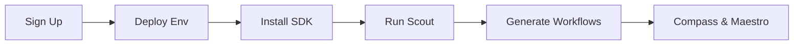

## Prerequisites

Before starting, ensure you have the following:

<Callout kind="info">
- Node.js `{>=18}` or Python `{>=3.10}`
- Docker installed for private deployments
- Access to your private cloud or on-premises environment
- A free Percepteye AI account (create one in the next section)
</Callout>

## Create a Free Account and Demo

Sign up for early access to deploy Scout, the discovery agent.

<Steps>
  <Step title="Visit Dashboard" icon="monitor">
    Go to [https://www.percepteye.ai/demo](https://www.percepteye.ai/demo) and click **Start free**.
  </Step>
  <Step title="Sign Up" icon="user-plus">
    Enter your email and create a password. Verify your email.
  </Step>
  <Step title="Get API Key" icon="key">
    Navigate to **Settings > API Keys** in the dashboard. Copy your `{API_KEY}`.
  </Step>
</Steps>

<Callout kind="tip">
  The free demo includes credits for Scout discovery and initial workflows.
</Callout>

## Deploy Your Environment

Percepteye AI supports deployment in private clouds or on-premises.

<Tabs>
  <Tab title="Private Cloud (AWS/GCP)" icon="cloud">
    <Steps>
      <Step title="Launch Instance" icon="rocket">
        Use the one-click deploy from your dashboard.
      </Step>
      <Step title="Configure VPC" icon="settings">
        Ensure ports `443` and `8080` are open.
      </Step>
    </Steps>

````dockerfile
docker run -d -p 8080:8080 \
  -e PERCEPTEYE_API_KEY={YOUR_API_KEY} \
  percepteye/scout:latest
````
  </Tab>
  <Tab title="On-Premises" icon="server">
    Download the binary from the dashboard.

    <CodeGroup tabs="Linux,macOS">
````bash
# Linux
curl -fsSL https://api.percepteye.ai/download/onprem | bash
sudo systemctl start percepteye-scout
````

````bash
# macOS
brew tap percepteye/tap
brew install percepteye-scout
brew services start percepteye-scout
````
    </CodeGroup>
  </Tab>
</Tabs>

## Install Agent Flywheel SDK

Install the lightweight SDK for observability and agent integration.

<CodeGroup tabs="npm,yarn,pip">
```bash
npm install @percepteye/agent-flywheel
```

```bash
yarn add @percepteye/agent-flywheel
```

```bash
pip install percepteye-agent-flywheel
```
</CodeGroup>

Initialize with your key:

````javascript
import { AgentFlywheel } from '@percepteye/agent-flywheel';

const sdk = new AgentFlywheel({
  apiKey: '{YOUR_API_KEY}',
  endpoint: 'https://api.percepteye.ai/v1'
});

await sdk.init();
````

## Run Your First Scout Discovery

Scout maps your systems and generates candidate workflows.

<Steps>
  <Step title="Connect Systems" icon="link">
    Use the SDK to point Scout at your APIs.

````javascript
const discovery = await sdk.scout.discover({
  endpoints: ['https://your-api.com/graphql', 'https://internal.service']
});
````
  </Step>
  <Step title="Run Scan" icon="search">
    Trigger the discovery process.
  </Step>
  <Step title="Review Outputs" icon="list">
    Check the dashboard for mapped workflows.
  </Step>
</Steps>

## Generate Initial Workflows

Once discovery completes, generate your first workflows automatically.

```javascript
const workflows = await sdk.scout.generateWorkflows({
  systems: discovery.systems,
  goals: ['user authentication', 'data sync']
});

console.log(workflows); // Array of workflow objects
```

<Callout kind="success">
  Workflows are ready for Compass fine-tuning.
</Callout>

## Next Steps

<Columns cols={2}>
  <Card title="Explore Compass" icon="compass" href="/authentication">
    Turn workflows into training data.
  </Card>
  <Card title="Deploy Maestro" icon="cpu" href="/guides">
    Train and evaluate models autonomously.
  </Card>
  <Card title="SDK Reference" icon="code" href="/configuration">
    Full API for Agent Flywheel.
  </Card>
  <Card title="Changelog" icon="git-branch" href="/changelog">
    Latest updates and releases.
  </Card>
</Columns>



<Expandable title="Troubleshooting Common Issues" default-open="false">
- **API Key Invalid**: Regenerate in dashboard.
- **Discovery Timeout**: Increase `{timeout: 300000}` in SDK config.
- **Docker Issues**: Verify ports and firewall rules.
</Expandable>